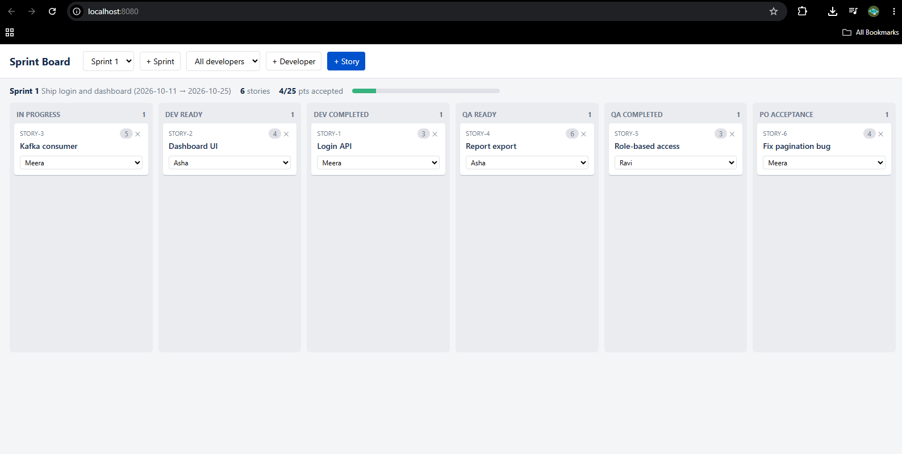

# Agile Sprint Board (Spring Boot + vanilla JS)

Run: `mvn spring-boot:run`, then open http://localhost:8080
(H2 console: `/h2-console`, JDBC `jdbc:h2:file:./data/agiledb`)

Workflow: In Progress → Dev Ready → Dev Completed → QA Ready → QA Completed → PO Acceptance (drag cards between columns).

## Documentation
- [docs/HLD.md](docs/HLD.md): goals, requirements, design decisions, roadmap, risks
- [docs/ARCHITECTURE.md](docs/ARCHITECTURE.md): context, component, ER, state, sequence and deployment diagrams (Mermaid)
- [docs/API.md](docs/API.md): REST API reference
