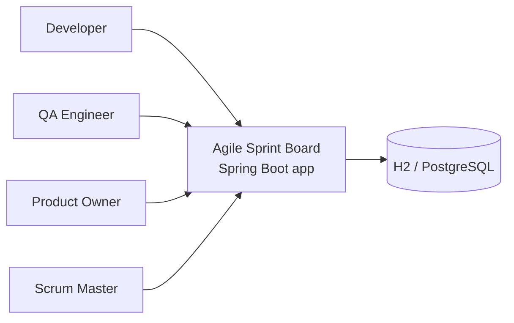
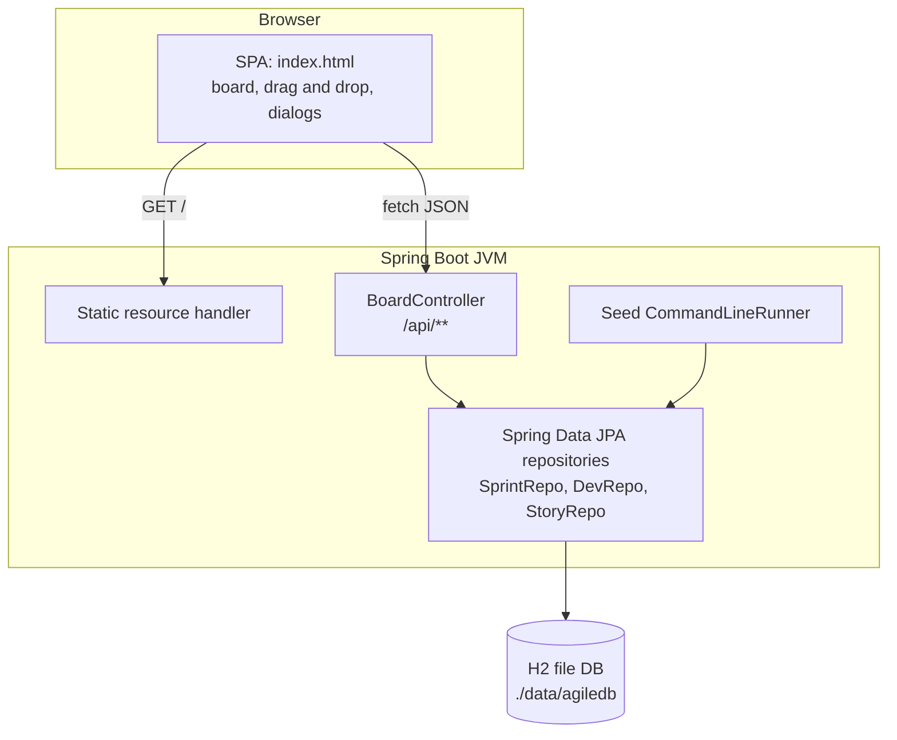
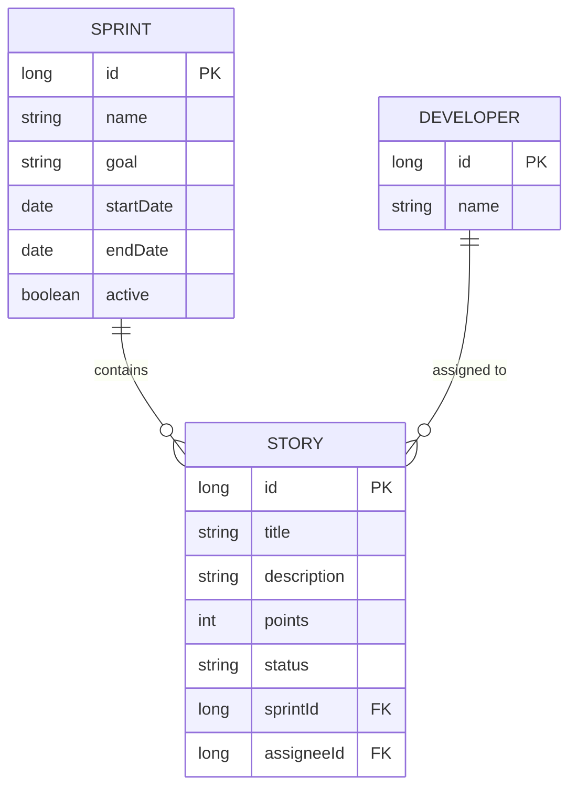
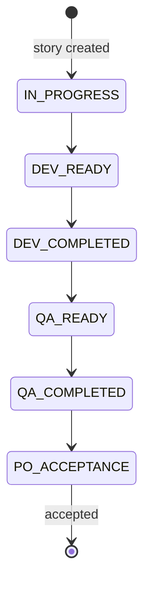
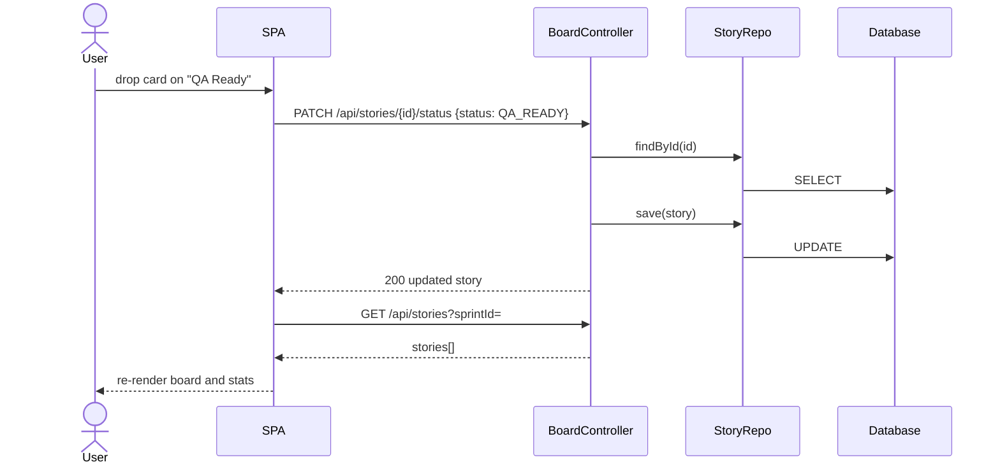
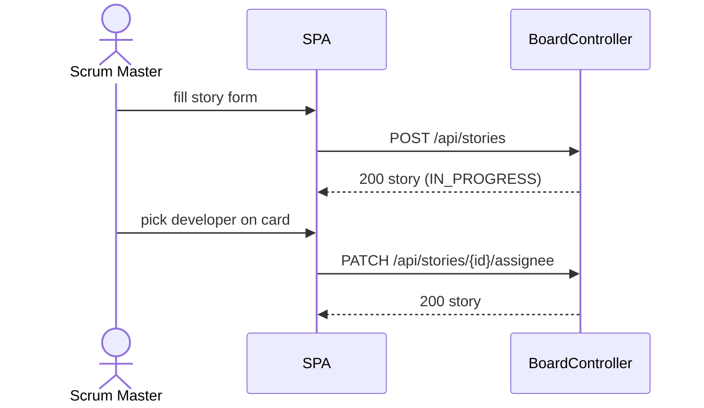
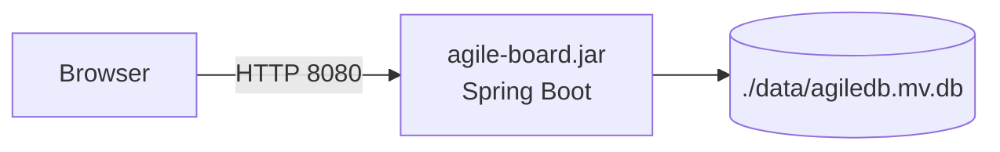
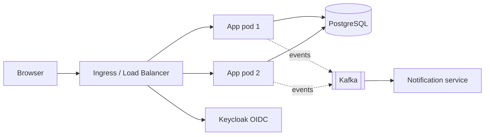

# Architecture Design

Diagrams use Mermaid (rendered by GitHub, GitLab, VS Code Markdown preview).

## 1. System Context


## 2. Container / Component View (current v1)


## 3. Layered Design
| Layer | Technology | Notes |
|---|---|---|
| UI | HTML, CSS, JS | Re-renders board from API state |
| Web / API | Spring MVC `@RestController` | JSON, stateless |
| Persistence | Spring Data JPA + Hibernate | `ddl-auto=update` in v1 |
| Storage | H2 file database | Replace with PostgreSQL in v2 |

## 4. Data Model (ER)


## 5. Workflow State Machine

v1 also permits backward moves (e.g. QA rejects, back to IN_PROGRESS).

## 6. Sequence: Drag a Card to a New Column


## 7. Sequence: Create Story and Assign Developer


## 8. Deployment View
**v1 (current):** one JVM process.

**v2 (target):**


## 9. Cross-Cutting Concerns
| Concern | v1 | v2 |
|---|---|---|
| AuthN/AuthZ | None | Keycloak + Spring Security, roles Dev/QA/PO/SM |
| Validation | Minimal (UI) | Bean Validation on DTOs, 400 error model |
| Error handling | Spring defaults | `@ControllerAdvice` with problem+json |
| Concurrency | Last write wins | `@Version` optimistic locking, 409 on conflict |
| Observability | Console logs | Actuator, Micrometer, Prometheus, structured logs |
| Testing | None | JUnit 5, MockMvc, Testcontainers (PostgreSQL) |
| Config | `application.properties` | Profiles (dev, prod), env-based secrets |

## 10. Suggested Package Structure (v2 refactor)
```
com.agile.board
 ├─ web         controllers, DTOs, exception handler
 ├─ service     SprintService, StoryService (transition rules)
 ├─ domain      entities, Status enum
 ├─ repo        Spring Data repositories
 ├─ event       StoryStatusChanged, Kafka publisher
 └─ config      security, OpenAPI, CORS
```

## 11. Scalability Notes
- App tier is stateless, so it scales horizontally behind a load balancer once the DB is shared.
- Main query is `findBySprintId`; add an index on `story(sprint_id)` and `(sprint_id, status)`.
- For live boards, use SSE/WebSocket fan-out (Redis pub/sub when multi-node).
